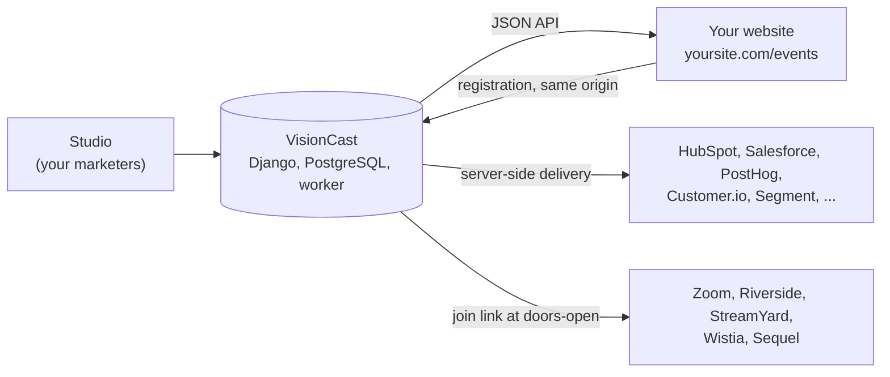

<h1>
  <picture>
    <source media="(prefers-color-scheme: dark)" srcset="docs/brand/visioncast-logo-dark.svg">
    
  </picture>
</h1>

**The open-source headless CMS for webinars.** Your event pages and registration form live on your own website. Your registrations go straight to the tools you already use. Your video stays in Zoom, Riverside, StreamYard, Wistia or Sequel.

[](LICENSE)
[](https://github.com/B2B-Saas-Inc/visioncast/releases)
[](docs/remaining-gaps.md)

[See it live](https://growthcast.app/events) · [Quick start](#quick-start) · [Implementation guide](docs/implementation-guide.md) · [Releases](https://github.com/B2B-Saas-Inc/visioncast/releases)

> **Pre-release.** VisionCast runs in production at growthcast.app, but it isn't certified for general production use yet. Read [Status](#status) before you depend on it.

## Why VisionCast

Your webinar page should live on your website. For most teams, it lives on someone else's.

Here's how a webinar usually runs. Marketing builds the page inside the webinar tool, on the vendor's subdomain, in the vendor's template. The form asks for three fields. A sync copies registrants into the CRM, often without the campaign that brought them and sometimes twice. A developer loses an afternoon to an iframe that won't resize on a phone. Then the renewal lands, priced per attendee.

VisionCast fixes the part you actually care about. Your marketers build events in a studio. Your website pulls those events through an API and renders the page and the registration form on your domain, with your own components. VisionCast sends each registration from your server straight to HubSpot, Salesforce, PostHog or whatever you already pay for. The video stays where it is.

You keep the page. You keep the data. Nobody can reprice either one.

### Who it's for

* **Marketing teams that run webinars every month.** You want event pages that look like the rest of your site, rank under your domain and convert like your best landing page.
* **Marketing ops and RevOps.** You want one person per registrant, with the right source and consent, in HubSpot, Salesforce or PostHog. No Zapier chain in the middle.
* **The developer who gets the ticket.** You want JSON, a form script and a component for the framework you already use. Not an iframe.
* **Whoever signs the renewal.** You want a program that no vendor can cap, reprice or retire.

### What changes

| Today | With VisionCast |
|---|---|
| Event pages on the vendor's subdomain, in the vendor's template | Event pages at `yoursite.com/events`, built with your own components |
| An embed that won't style, won't resize on mobile, or isn't supported any more | A JSON API, a dependency-free form script, and kits for WordPress, Next.js, Astro, SvelteKit, Nuxt, Sanity, Contentful, Payload and Prismic |
| A three-field form, synced late, missing the UTMs, sometimes twice | Your own fields, sent server-side to 17 tools with consent rules. One person per verified email, merged with the anonymous website visitor in PostHog, Amplitude and Mixpanel |
| Pricing per attendee or per contact, attendee caps, annual escalators | Apache 2.0. No vendor caps, no seats, no contract. You pay for a server |
| A new video tool means rebuilding every page | You pick the video tool per session. Pages and data stay put |

### Why open source

People pick hosted webinar platforms for good reasons: built-in video, one bill, nothing to run. The trade is that the vendor owns the page, the data path and the price. Between December 2025 and April 2026, Cvent bought both [Goldcast and ON24](https://www.forrester.com/blogs/why-cvent-acquired-on24-and-goldcast-and-what-comes-next/). If you rent your webinar program, the people merging those companies now decide your roadmap.

VisionCast is Apache 2.0. There's no "powered by" badge and no paid tier holding back the useful parts. Fork it, change it, run it next to your website. Your registrants live in your PostgreSQL database.

### Is it right for you?

It's a good fit if you have a developer and want your events on your own site. It's the wrong choice today if nobody on your team can run a Docker image, or if you want a built-in video studio. A hosted platform will serve you better there.

## How it works



1. Marketers create an event in the studio from a template, add sessions and pick a registration form. VisionCast won't publish until the event has an upcoming session and the copy it needs.
2. Your website reads published events from the public API and renders `/events` and `/events/<slug>` with its own components. A kit or the form script renders the registration form from the event's form schema.
3. The form posts to your own origin. A small first-party proxy forwards it to VisionCast with a server-held key, so visitors never talk to a third-party domain.
4. VisionCast stores the registration, sends a calendar invite link, and queues one delivery per integration. A background worker sends each one, retries failures and keeps a log your team can replay.
5. On the day, the hosted waiting room checks people in and reveals the join link when the doors open. Attendance comes back from Zoom or a file import and flows to the same integrations.

## Features

### For marketers

* **A studio built for running a program.** Templates with complete copy, Attention / Interest / Decision / Action fields, learning outcomes, hosts and topics, revision history, and a readiness check before anything goes public. [docs/studio.md](docs/studio.md)
* **A form builder.** Pick standard fields, add custom ones, reorder, and version forms so past registrations stay consistent. [docs/field-mapping.md](docs/field-mapping.md)
* **Sessions that behave.** Recurring series, real time zones (daylight-saving edge cases included), reschedules and cancellations that update calendar invites instead of duplicating them, and reminders that skip when late.
* **A hosted waiting room.** A stable room link per session reveals the join URL only when the doors open and records check-ins as attendance. [docs/waiting-room.md](docs/waiting-room.md)
* **Seats and paid tickets** (preview). Hard seat limits with holds, Stripe Checkout, and a verified mailbox before any paid seat. Refunds stay in Stripe. [docs/tickets.md](docs/tickets.md)
* **Reports and roles.** Registration and attendance per session, delivery health, and Administrator / Editor / Analyst roles with personal data masked for Analysts.

### For marketing ops

* **17 native integrations** (tested against mocked vendor APIs; not yet live-verified): PostHog, HubSpot, Salesforce, Customer.io, Attio, Segment, Google Analytics 4, Amplitude, Mixpanel, RudderStack, Brevo, Pipedrive, ActiveCampaign, Mailchimp, beehiiv, Resend and Amazon SES. You add the API key once in the studio; VisionCast only ever sends it to that vendor's own host. [docs/native-integrations.md](docs/native-integrations.md)
* **Identity that doesn't create duplicates.** PostHog, Amplitude and Mixpanel identify people by verified email, and VisionCast merges in the anonymous visitor ID your website already tracked.
* **Consent and attribution.** Analytics, advertising and SMS consent travel with every registration and gate every integration. UTMs, click IDs and first-party cookies are captured only with the matching consent, with separate first-touch and registration-touch records.
* **Signed webhooks.** Timestamped HMAC signatures, stable delivery IDs, per-destination data groups, and ready recipes for Zapier, Make and n8n. [docs/webhooks.md](docs/webhooks.md)
* **Attendance from the source.** Pull attendance from Zoom, Riverside (unverified) or a file from any provider. It never runs automatically and never guesses an ambiguous match. [docs/hosting.md](docs/hosting.md)

### For developers

* **APIs.** A public read API, a registration API with idempotency keys, a first-party proxy API, and a management API for events, sessions, forms and attendance. OpenAPI 3.1 at `/api/v1/openapi.json`. [docs/api-reference.md](docs/api-reference.md), [docs/management-api.md](docs/management-api.md)
* **Website kits.** A WordPress plugin; references for Next.js, Astro, SvelteKit, Nuxt, React, Vue and Svelte; CMS integrations for Sanity, Contentful, Payload and Prismic; a dependency-free form script and a Google Tag Manager tag. The WordPress plugin and the Next.js, SvelteKit, Astro and Nuxt kits were each installed fresh in Docker; none is production-tested on a real site yet. [docs/kits.md](docs/kits.md)
* **Recognition without accounts.** A returning browser skips fields it already gave, through a revocable HttpOnly cookie. An email address alone never reveals or changes anyone's profile.
* **Hosting providers** (preview). Create, update or attach Zoom Webinars; create Wistia and Sequel sessions; attach Riverside with per-registrant links; manual links for StreamYard. [docs/hosting.md](docs/hosting.md)
* **An MCP server.** Claude and other assistants can draft events, schedule sessions, record attendance and pull reports with a scoped key, under the same rules as your team. [docs/mcp.md](docs/mcp.md)

### For whoever runs it

* **One image.** Django 5.2 LTS, PostgreSQL 16 and a background worker ship in a single Docker image for linux/amd64 and linux/arm64, published to GHCR on every release.
* **Production tooling.** Scripts provision a 2 GB DigitalOcean droplet, install everything behind Cloudflare with TLS, rate limits and Access, take nightly encrypted backups, and upgrade in place with a backup first. [deploy/production/README.md](deploy/production/README.md)
* **Privacy controls.** A retention and erasure command, a personal-data-free audit log, encrypted credentials, and outbound requests restricted to approved hosts.

## What VisionCast is not

* **Not an email platform.** Confirmations, reminders and follow-ups go out as events (`registration.created`, `reminder.due`, ...) for your email tool to send. VisionCast only sends its own operational mail: waiting-room codes and teammate invitations. [docs/email.md](docs/email.md)
* **Not a video platform.** Join and recording links point at your existing webinar tool. The waiting room controls when the join link appears.
* **Not multi-tenant, and not a CRM.** One install serves one organisation. It doesn't verify phone numbers, and it verifies email addresses only through the waiting-room code.

## Quick start

Run VisionCast locally with Docker Compose. You need Docker with Compose v2, git, and Python 3 for generating secrets.

```sh
cp .env.example .env && chmod 600 .env
# Generate and paste secrets into .env:
python3 -c "import secrets; print(secrets.token_urlsafe(50))"                             # DJANGO_SECRET_KEY
python3 -c "import secrets; print(secrets.token_urlsafe(32))"                             # POSTGRES_PASSWORD
python3 -c "import base64, os; print(base64.urlsafe_b64encode(os.urandom(32)).decode())"  # INTEGRATION_MASTER_KEY
# Edit hosts and origins (DJANGO_ALLOWED_HOSTS, CSRF_TRUSTED_ORIGINS, PUBLIC_BASE_URL,
# WEBINAR_ALLOWED_ORIGINS, THANK_YOU_REDIRECT_HOSTS, WEBHOOK_HOST_ALLOWLIST).

deploy/build-image.sh                                   # builds webinar-platform:<version>
echo "WEBINAR_IMAGE=webinar-platform:$(cat VERSION)" >> .env
docker compose run --rm migrate
docker compose run --rm web manage sync_roles
docker compose run --rm web manage bootstrap_admin --username admin --email admin@example.com
docker compose run --rm web manage create_api_key --name "site proxy" --scope proxy
docker compose up -d
docker compose ps                                       # web and worker "healthy"
```

Add sample events with `docker compose run --rm web manage seed_public_demo`. The stack expects HTTPS in front of it; to browse the studio at `http://127.0.0.1:8000/studio/` on your own machine only, also set `DJANGO_SECURE_SSL_REDIRECT=0`, `DJANGO_SESSION_COOKIE_SECURE=0`, `DJANGO_CSRF_COOKIE_SECURE=0` and `CSRF_TRUSTED_ORIGINS=http://127.0.0.1:8000` in `.env`, then sign in with the password `bootstrap_admin` printed.

* `bootstrap_admin` prints a generated password once, or reads `BOOTSTRAP_ADMIN_PASSWORD` (remove it from `.env` afterwards). There are no default passwords; the stack refuses to start without its secrets.
* The API key is printed once. It belongs in your first-party proxy (`sdk/proxy/`), never in page source or GTM.
* The web port binds to `127.0.0.1:8000`: studio at `/studio/`, Django admin at `/admin/`, health at `/healthz`.
* Container roles (`docker/entrypoint.sh`): `web` (gunicorn), `worker` (`run_worker`), `migrate` (explicit, never automatic) and `manage <args>`.
* Other commands: `show_version [--verbose]`, `purge_personal_data --person <uuid> | --older-than-days N [--dry-run]`, `set_destination_secret`, `sync_roles`. Day-two operations: [docs/operations.md](docs/operations.md).

### Use the published image

Every `v<VERSION>` tag builds linux/amd64 and linux/arm64 images with an SBOM and provenance. The current release is **`ghcr.io/b2b-saas-inc/visioncast:0.3.7-pre`** (digest `sha256:4eab0002d4f5c31702a6f6a4a29ba8bb03a0f02124bafe9836c590fc4fd5a368`). The package is private for now, so pulling needs a GitHub token with `read:packages`.

```sh
docker pull ghcr.io/b2b-saas-inc/visioncast:0.3.7-pre
# in .env:  WEBINAR_IMAGE=ghcr.io/b2b-saas-inc/visioncast:0.3.7-pre  and  WEBINAR_PULL_POLICY=never
deploy/upgrade.sh --image ghcr.io/b2b-saas-inc/visioncast:0.3.7-pre   # first run: docker compose run --rm migrate && docker compose up -d
```

## Deploy to production

[`deploy/production/`](deploy/production/README.md) takes a fresh DigitalOcean droplet to a working install: Docker Compose, nginx with Let's Encrypt, Cloudflare in front, nightly encrypted backups, retention, and a PASS/FAIL verifier. It's the tooling behind events.growthcast.app.

```sh
deploy/production/provision.sh --apply                      # creates the droplet (dry run without --apply)
deploy/production/package-release.sh v0.3.7-pre             # source tarball from a tag
deploy/production/update.sh --host <ip> --tarball dist/visioncast-0.3.7-pre.tar --upload-only
# on the droplet: bootstrap.sh (see deploy/production/README.md)
deploy/production/verify.sh --domain events.example.com --expect-access
```

Upgrades use the same `update.sh` with a new tarball: it backs up, migrates, restarts and health-checks, and keeps the previous release beside the new one for rollback.

Whatever you deploy on, put these at the edge before any public traffic. The production tooling sets all three up; [docs/operations.md](docs/operations.md) covers other hosts.

1. **TLS** that always overwrites `X-Forwarded-Proto`, then `DJANGO_TRUST_X_FORWARDED_PROTO=1`.
2. **Rate limits** on registration, profile, reset, studio and admin login, `/w/` and `/mcp`. The application's own limits are per process only.
3. **MFA, SSO or a VPN** in front of `/studio/` and `/admin/`. VisionCast itself only has passwords.

## Connect your website

The [implementation guide](docs/implementation-guide.md) walks through pages, forms, the proxy, the waiting room, calendars and webhooks from start to finish. In short:

1. Create a key with the `proxy` scope in the studio under **API keys**.
2. Route `/webinar-api/*` on your site to the first-party proxy (`sdk/proxy/server.js`, or the Next.js, Astro, SvelteKit or Nuxt kit), with the key in the server environment.
3. Render `/events` and `/events/<slug>` from `GET /api/v1/events` and `GET /api/v1/events/<slug>`.
4. Add the form: copy the snippet from a session's **Embed on your site** page, or use a kit component.
5. Add integrations in the studio under **Integrations**. Native providers need only their API key.

[docs/browser-integration.md](docs/browser-integration.md) covers the form script, consent and Google Tag Manager. [docs/kits.md](docs/kits.md) lists every kit.

## Identity model

Read this before you integrate. There is **no email verification for free registrations**. VisionCast recognises a browser only by the HttpOnly capability cookie it issued to the browser that created the person. Paid seats are the exception: the buyer proves the mailbox with a waiting-room code before any hold or checkout ([docs/tickets.md](docs/tickets.md)).

* **No account recovery and no cross-device recognition.** A second browser or device never gets recognised as an existing person.
* **An existing email from an unknown browser never updates that person.** VisionCast links the registration to the existing person only for per-session dedupe and marks it `identity_verified=false`. The person's profile and consent records stay unchanged; the submission stays on the registration.
* **"Not you?" doesn't recover an identity.** It revokes the browser's capability and shows the full form. An existing email submitted afterwards counts as unverified.
* **A replayed request never re-issues a cookie.** If a response carrying a new person's cookie is lost, an idempotent retry returns the stored body with a random, unbound decoy cookie.
* **Downstream rules.** Webhook payloads mark unverified registrations with `identity.verified=false`. Receivers must not merge those into verified CRM records, and must not send SMS unless the payload is verified and grants SMS consent for that number. Native integrations follow the same rule and skip unverified registrations. [docs/webhooks.md](docs/webhooks.md)

Full rules: [docs/architecture.md](docs/architecture.md#identity-rules) and [docs/security.md](docs/security.md).

## Roles and API key scopes

| Studio role | Can |
|---|---|
| Administrator | Everything in the studio: events, people, integrations, API keys, deliveries, audit log, reports. Can view, but not change, users and groups. |
| Editor | Events, sessions, series, hosts, topics, forms and attendance entries. No personal-data screens. |
| Analyst | Read-only events and registrations (personal data masked) and reports. |

Only **superusers** manage users, groups and role membership. `bootstrap_admin` creates the first account as a superuser in the Administrator group; give everyone else a role, not superuser status. Run `sync_roles` after every upgrade.

| API key scope | Allows |
|---|---|
| `register` | `POST /api/v1/registrations` from a server (no browser cookie). |
| `proxy` | Registration plus profile, reset and registration status, forwarding the browser cookie (first-party proxy). |
| `trusted` | **Privileged.** Registration from a trusted server; organisation IDs stored as verified. |
| `content_write` | Management API: events, hosts, topics, forms, sessions, cancellation. |
| `attendance_write` | Management API: attendance only. |
| `publication` | **Privileged.** Event visibility changes (with `content_write`) and recordings, both confirmed with a 428 round trip; MCP publication tools. |
| `config_read` | Read-only management access to events, sessions and waiting rooms, drafts included; redacted configuration over MCP. |
| `public_read`, `reporting` | MCP only: public read tools and resources; report summary. Public REST reads need no key. |
| `delivery_admin`, `keys_admin`, `team_admin` | **Privileged.** MCP only; see [docs/mcp.md](docs/mcp.md). |
| `payments_admin` | **Privileged.** Stripe account (set-only secrets), prices, orders and refunds recorded from Stripe. No money moves through the API. |
| `hosting_admin`, `hosting_provision` | **Privileged.** Hosting accounts with set-only credentials; provider session create, update, attach and reconcile. |

No scope implies another. VisionCast stores keys hashed and shows each one once. Only a superuser can grant a privileged scope, in the studio or with `manage.py create_api_key`.

## Status

VisionCast is a pre-release. Here is exactly where it stands on **0.3.7-pre** (2026-10-29). [docs/validation.md](docs/validation.md) records every run with its date; [docs/remaining-gaps.md](docs/remaining-gaps.md) and [docs/release-checklist.md](docs/release-checklist.md) list what's left.

**Proven**

* 2,453 automated tests pass on Python 3.12 and PostgreSQL 16, with lint, system and migration checks clean.
* A real-browser walkthrough of the studio passes 13 of 13 steps, plus browser suites for the form script, Google Tag Manager tag and Riverside flow.
* An end-to-end acceptance test covers create, provision, register, pay, check in, record attendance and deliver.
* Images build for amd64 and arm64 and publish to GHCR on every tag; backup, restore, in-place upgrade and rollback have been rehearsed.
* VisionCast runs in production at [events.growthcast.app](https://events.growthcast.app/healthz) behind Cloudflare, serving [growthcast.app/events](https://growthcast.app/events), upgraded in place since its first install on 0.3.0-pre.

**Not yet proven**

* Native integrations, Stripe and hosting providers have only been tested against mocked vendor APIs. Each needs a live sandbox run before you rely on it.
* Website kits were installed fresh in Docker but not on a real production site.
* Nobody has run a security audit or load test.

## Development

**Authoritative tests** run in containers against PostgreSQL:

```sh
docker compose up -d db
docker compose --profile test run --rm test                                            # full suite
docker compose --profile test run --rm test tests/test_registration_api.py -k idempotency
```

**Fast local loop** with [uv](https://docs.astral.sh/uv/). SQLite gives quick feedback only; it isn't evidence of PostgreSQL behaviour and skips the concurrency tests.

```sh
uv venv --python 3.12 .venv && . .venv/bin/activate
uv pip install -r requirements-dev.txt
DJANGO_TEST_SQLITE=1 pytest
ruff check .
```

**Browser and SDK tests:**

```sh
(cd sdk && npm test)             # node --test, no dependencies
node tests/browser-sdk.cjs       # needs the playwright package and Chromium
node tests/browser-gtm.cjs
node tests/browser-studio.cjs    # against a running studio (STUDIO_BASE_URL, STUDIO_USERNAME, STUDIO_PASSWORD)
```

Issues and pull requests are welcome. Please include a test with every behaviour change and record release evidence in [docs/validation.md](docs/validation.md).

## Documentation

| Document | Contents |
|---|---|
| [docs/implementation-guide.md](docs/implementation-guide.md) | **Start here.** Deployment, pages, forms, proxy, waiting room, calendars, webhooks, launch checks |
| [deploy/production/README.md](deploy/production/README.md) | Production install on a droplet behind Cloudflare, upgrades, verification |
| [docs/studio.md](docs/studio.md) | The marketer studio |
| [docs/kits.md](docs/kits.md), [docs/browser-integration.md](docs/browser-integration.md), [docs/integration.md](docs/integration.md) | Website kits, form script, consent, first-party proxy, Google Tag Manager |
| [docs/native-integrations.md](docs/native-integrations.md), [docs/webhooks.md](docs/webhooks.md) | Native integrations; webhook payloads, signatures, retries |
| [docs/waiting-room.md](docs/waiting-room.md), [docs/tickets.md](docs/tickets.md), [docs/hosting.md](docs/hosting.md), [docs/email.md](docs/email.md) | Waiting room, seats and paid tickets, hosting providers, operational email |
| [docs/api-reference.md](docs/api-reference.md), [docs/management-api.md](docs/management-api.md), `GET /api/v1/openapi.json` | Public, registration, proxy and management APIs; OpenAPI 3.1 |
| [docs/mcp.md](docs/mcp.md) | MCP server for AI assistants |
| [docs/field-mapping.md](docs/field-mapping.md), [docs/field-dictionary.md](docs/field-dictionary.md), [docs/registration.schema.json](docs/registration.schema.json) | Form schema, field mapping, registration JSON Schema |
| [docs/architecture.md](docs/architecture.md) | Components, identity rules, outbox design, roles |
| [docs/security.md](docs/security.md), [docs/threat-model.md](docs/threat-model.md) | Security behaviour, threats and residual risks |
| [docs/operations.md](docs/operations.md) | Edge setup, key rotation, backup and restore, upgrade and rollback, retention, logging |
| [docs/validation.md](docs/validation.md), [docs/remaining-gaps.md](docs/remaining-gaps.md), [docs/release-checklist.md](docs/release-checklist.md) | Release evidence, open gaps, release gates |
| [examples/verify_webhook.py](examples/verify_webhook.py) | Replay-safe webhook signature check |

## Security and supply chain

* `requirements.txt` is a hash-locked transitive lock, and the image build installs it with `pip --require-hashes`. `pip-audit` reported no known vulnerabilities on 2026-10-27; rerun it on every lock change.
* Base images are pinned by multi-platform digest in the `Dockerfile` and `compose.yaml`. To refresh, run `docker buildx imagetools inspect python:3.12-slim-bookworm` and `postgres:16-alpine`, paste the new digests, rebuild, and record them in [docs/validation.md](docs/validation.md).
* The image runs as uid 10001 with a read-only root filesystem, all capabilities dropped and `no-new-privileges`. The build context is an allowlist (`.dockerignore`).
* Every image carries OCI labels and reports its version at `/healthz`, `manage.py show_version` and the MCP `serverInfo`.

## License

Apache License 2.0. See [LICENSE](LICENSE).
